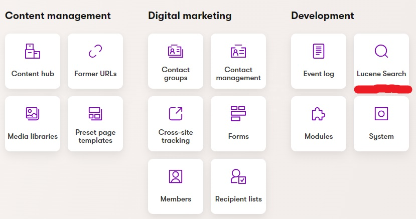

# Managing Indexes

This section is relevant for `Kentico.Xperience.Lucene.Admin` NuGet package.

## Module classes in the administration

The **Kentico Integration - Lucene** module uses the code name `CMS.Integration.Lucene`.
The `CMS` prefix intentionally prevents Xperience from generating C# classes that duplicate
the Info classes already shipped by this integration.

Xperience therefore identifies it as a default system module: its settings are read only,
and its Classes tab hides the integration's `Other` classes outside development mode.
An empty Classes tab does not mean the module tables or object types are missing.
Manage indexes through the Lucene application; use the package's Info classes or the
Management API to inspect the module metadata. Keep the module code name unchanged.

To manage a search index in the Xperience administration, navigate to the Search application on the dashboard.

Create a new index or open an existing index by clicking its row or the pencil icon.

The Configuration tab shows a compact, read-only hierarchy of all settings, channels,
paths and selected content types. Use a section's Edit action to open its form in a side
panel. Only one section is edited at a time; Save commits its changes and Cancel discards them.
The save confirmation reminds you to rebuild after changing what or how content is indexed;
saving configuration does not rebuild the index.
Content types show their display name followed by their code name. Unknown types retain
their code name; record details show the actual stored values.

- Display Name - the name shown in the administration, including breadcrumbs and side navigation. Indexes created before display names existed show their code name.
- Code Name - the name used in code to find the index. It is locked after creation.
- Included Reusable Content Types - these are the reusable content types that will be processed by your custom indexing strategy.
If no option is selected, no items will be processed.
- Indexed Languages - the index will only include content in the selected languages.
- Indexing Strategy - the indexing strategy specified in code during dependency registration of a custom indexing strategies.
  - In case you do not want the default strategy to appear here, use the builder and set the `IncludeDefaultStrategy` property to `false`.
- Lucene Analyzer - the Lucene analyzer which indexes use to analyze text.
  - In case you do not want the default `Standard` analyzer to appear here, use the builder and set the `IncludeDefaultAnalyzer` property to `false`.
- Rebuild Hook - for validating a request rebuild of the search index from an external source (ex: API request).

Configure website channels from the Website channel content section.
Use Add website channel to include another channel.
The index will only be triggered by web page item creation or modification in the selected website channel.

Each channel shows all its paths and selected content types. Open its editor to add or
remove paths and change their content types. Search the content type picker to add types;
selected types remain visible without opening the picker. Cancel leaves the saved
configuration unchanged.

- Included Path - can be an exact relative path of a web page item, (ex: `/path/to/my/page`), or a wildcard path (ex: `/parent-path/%`)
  - To determine a web page path, select the web page in the website channel page tree, then view the "Current URL" in the Content tab of the web page. The path will be the relative path excluding the domain
- Included ContentType items - these are the web page content types that can be selected for the path. Each content type in the multi-select enables modification to web pages of that type to trigger an event that your custom indexing strategy can process. If no option is selected, no web pages will trigger these events.

## Creating an index

New indexes are created with a guided flow: identity (display name, code name), content (channels, paths with a wildcard preview, content types), languages and analyzer (with warnings when a language-specific analyzer does not match a selected language), strategy, and review. Field mapping is defined in code by the indexing strategy.

The Content step separates website page and reusable content configuration from the
read-only path preview. Preview results identify their channel, path and language;
sample pages are not submitted as configuration.

## Inspecting an index

Opening an index shows the tabs Overview, Configuration and Search. Search and
diagnostics are read only. Authorized users can queue a rebuild from the Rebuild button
in Overview's Index health panel.

- Overview - configuration and operational status in a two-column layout: search availability, generations, document counts, last updated, last rebuild request, and diagnostics (items selected, skipped by the strategy, missing from the index, stored but not selected). Refresh reloads the current values.
- Search - browse all documents in the published generation or use Add filter to narrow results. All active filters must match. Results appear in a compact, paginated listing. Select a result to open its stored fields and metadata in a side panel, including the score explanation for query matches.

Text filters analyze plain words; exact fields match the indexed value, including case.
Boolean fields offer Any, Yes and No. Text and exact fields also accept `*` (any number
of characters) and `?` (one character). For example, filter `Url` by `*arabica*`,
`ContentTypeName` by `DancingGoat.*`, or `Title` by `coff*`. Patterns match indexed terms,
not the original full text. Text wildcard terms are lowercased but not stemmed; exact
field patterns preserve case. Leading wildcards are supported in filters but can be
slower on large indexes. In exact fields, `\*` and `\?` match literal wildcard characters.

Choose Lucene query (advanced) for full query syntax, such as `Title:coffee AND
LanguageName:en` or `Title:"coffee beans"`. The configured analyzer applies and
unqualified terms use OR. Use field names actually indexed by the strategy; the sample
indexes `Title` and `Content`, not the default `Name`. Advanced mode retains Lucene's
default restriction against leading wildcards.

Custom strategies can override `GetSearchFieldDescriptors()` to declare typed
searchable fields. Use `LuceneSearchFieldKind.Text` for analyzed fields, `Exact` for
untokenized values, and `Boolean` with the strategy's actual true/false encodings.
The inspector includes only fields present in the published index. Undeclared indexed
fields remain available through advanced queries; stored-only fields are not searchable.

Diagnostics categories use full-row controls rather than small disclosure arrows.
Each category has its own paged results list, with the total and current range below it.
Counts and lists identify distinct items by GUID and actual content language. Results
are held in a server-side snapshot for up to ten minutes; rerun diagnostics after content
changes or when a snapshot expires or is replaced by newer runs.

## Rebuild limitations

Rebuild queues items for background indexing. Progress, completion and cancellation are not tracked, and rebuild is not blue/green: the published generation is discarded when a rebuild starts, so searches can return no results until the new generation is published. Only the last rebuild request (in memory, per server) is shown. Content in fallback languages is not changed by these tools.

## Indexing reusable content items

All reusable content item modifications will trigger an event to generate a `IndexEventReusableItemModel` for your custom index strategy class to process, as long as the content item has a language variant matching one of the languages selected for the index. You can use this to index reusable content items in addition to web page items but returning the reusable content item content as a `IIndexEventItemModel` from the strategy `FindItemsToReindex` method.
